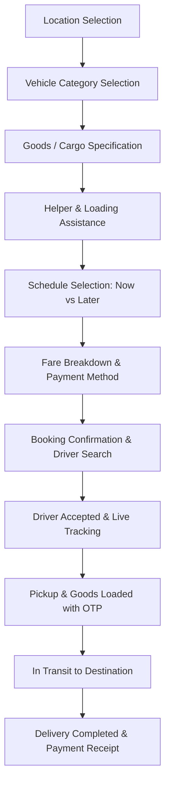

# CARRY — Booking Flow Specification

## 1. Step-by-Step Customer Journey

### Step 1: Location (`/booking/location`)
- Pickup location: Autocomplete search, current GPS position, or map pin drop.
- Drop-off location: Address input, contact name, and recipient phone number.
- Geocoding and route polyline distance calculation in kilometers.

### Step 2: Vehicle Selection (`/booking/vehicle`)
- Displays available vehicle categories in the operational city (e.g. 3-Wheeler Cargo, Tata Ace, Pickup Truck, Tata 407).
- Displays capacity (kg), dimensions, estimated arrival time (ETA), and upfront estimated price.

### Step 3: Cargo Details (`/booking/items`)
- Goods category: Electronics, Furniture, FMCG/Groceries, Industrial/Hardware, Moving/Household, Other.
- Approximate weight and fragile item flag.

### Step 4: Helper & Loading Support (`/booking/helpers`)
- Options: Driver help only, +1 Helper, +2 Helpers, or No assistance required.
- Clear fixed incremental fee added to the quote.

### Step 5: Schedule (`/booking/schedule`)
- Instant pickup (Within 10–15 minutes).
- Scheduled pickup (Date and time picker within 7 days).

### Step 6: Fare Review & Payment Method (`/booking/fare`)
- Base fare + per-km rate + helper charges + toll/taxes.
- Payment selection: UPI, Cash on Delivery (COD), or Netbanking/Card.

### Step 7: Confirmation & Matching (`/booking/confirmation`)
- Generates booking document in Firestore (`status: "searching"`).
- Nearby online drivers matching vehicle category receive high-priority push/in-app alert.

## 2. Driver Lifecycle States
1. `pending`: Waiting for a driver to accept the job.
2. `accepted`: Driver matched; heading to pickup point.
3. `arrived_pickup`: Driver arrived at pickup location.
4. `in_transit`: Goods loaded, verified with pickup OTP, driver en route to drop-off.
5. `completed`: Drop-off reached, unloading verified, payment collected.
6. `cancelled`: Cancelled by customer or driver (with reason code).
